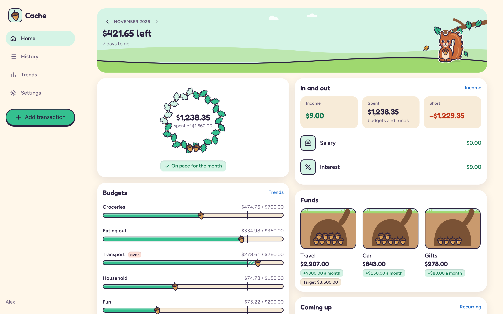
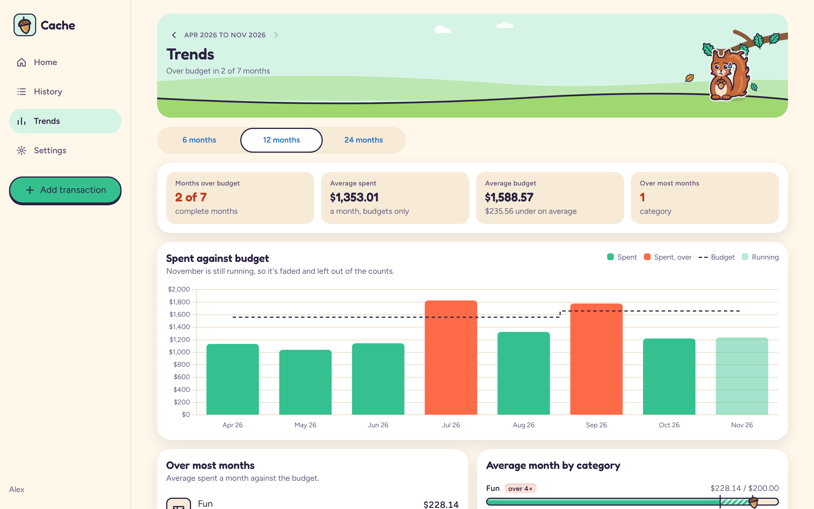
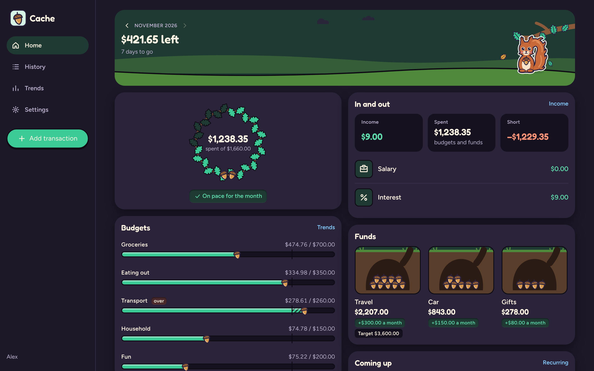
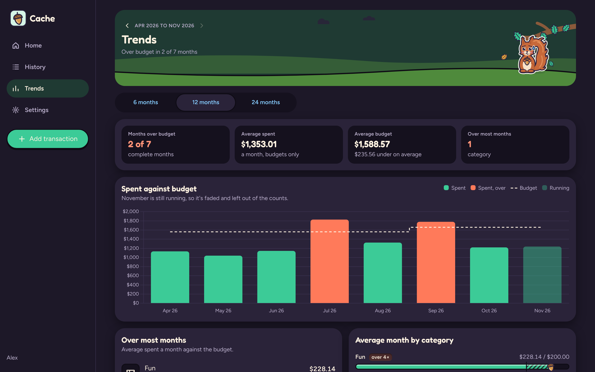
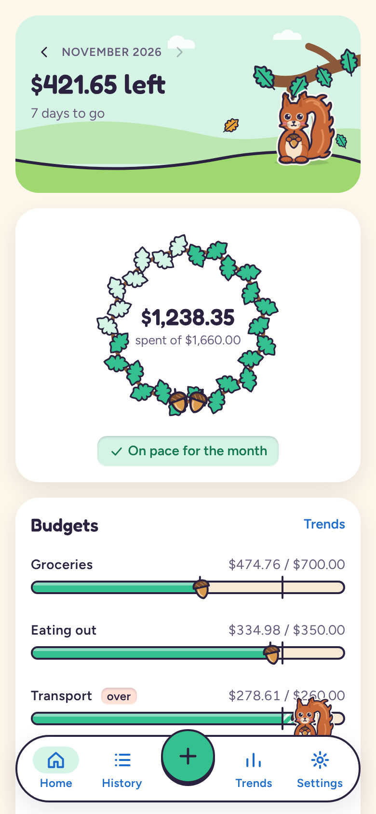
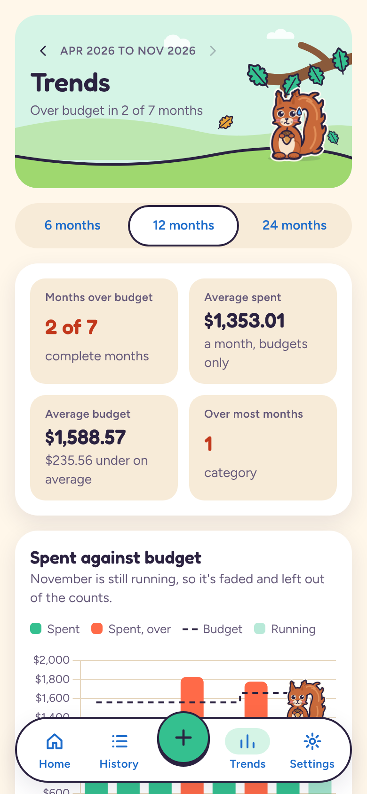

<h1 align="center">
  
  <br>
  Cache
</h1>

<h4 align="center">A self-hosted household money tracker with budgets and sinking funds.</h4>

Cache is a shared ledger for a household: everyone signs in and sees the same list of transactions, expenses and income.

* **Fast entry on a phone.** One page at a time, each above the keyboard: amount on a numpad, title (a past title brings its category), category, save. Date, month, note and repeat are optional on the last page.
* **Income and expenses.** Income categories for pay and the like; money back in a budget or fund counts against what was spent. Home and Trends show what came in, what went out and what was left over.
* **Budgets.** Each category has a monthly budget. Changing it applies from a month on, so past months keep the budget they had.
* **Sinking funds.** A fund grows by a set amount on the 1st of each month and shrinks by what you spend from it. Cache tracks the balance.
* **Date and month are separate.** A bill paid on 10 June can count toward May.
* **Recurring** expenses and income are added when they fall due, so editing one changes every entry still to come.
* **Trends** show which categories go over budget month after month, and whether each fund's top-up covers what you spend from it.
* A phone-first web app in the Burrow design system, with light and dark themes. Sign in with passkeys through [Pocket ID](https://pocket-id.org).
* An MCP server at `/mcp`, so Claude can read the ledger and log transactions. See [docs/MCP.md](docs/MCP.md).

<p align="center">
   
   
</p>
<p align="center">
     
</p>

## Set it up

You need:

- a machine that runs Docker with Compose
- a domain, with Caddy or another reverse proxy handling HTTPS
- [Pocket ID](https://pocket-id.org) for sign-in

Steps:

1. **Create a sign-in client in Pocket ID.** Call it `cache` and give it both callback URLs:
   - `https://cache.example.com/auth/web/callback` (signing in from the browser)
   - `https://cache.example.com/oauth/callback` (the claude.ai connector)

   Limit it to a user group with just your household, and copy the client ID and secret.
2. **Fill in the settings.** Copy [docker-compose.yml](docker-compose.yml) and [.env.example](.env.example) (as `.env`) to the server and fill in `.env`.
3. **Start it** with `docker compose up -d`. This uses the latest release. To stay on one version, set `CACHE_TAG=4.0.0` in `.env`.
4. **Point your proxy at it.** For Caddy:

   ```
   cache.example.com {
       reverse_proxy <host>:8000
   }
   ```

5. **Sign in** with your passkey and add categories in Settings. On your phone, use "Add to Home Screen".

Images are published to `ghcr.io/theepicflyer/cache` for amd64: `:X.Y.Z` and `:latest` for releases, `:nightly` for every merge to `main`.

### Backups and updates

Everything Cache keeps is in the `cache-data` Docker volume, mounted at `/data`.

| In the volume | What it is |
| --- | --- |
| `app.sqlite` (and `-wal`, `-shm`) | The live database. Don't copy these while Cache runs; a copy can be corrupt. |
| `backup/app.sqlite` | A consistent snapshot of the database, rewritten every day at `SNAPSHOT_HOUR` (3am). |
| `secret`, `mcp/` | Keys for sign-in, and which Claude connectors are connected. |

Point your backup tool (restic, for example) at the volume and leave out `app.sqlite*` at its top level. To restore, stop Cache, put the files back, and run:

```bash
docker compose run --rm cache npx warren restore /data/backup/app.sqlite
```

To update, run `docker compose pull && docker compose up -d`. If a release needs anything done by hand, its release notes say so under **Deploy actions**.

**Coming from the Django version (3.x or earlier)?** Its data was in Postgres. Export the ledger from the old database once and import it into the new one; [MIGRATIONS.md](MIGRATIONS.md) has the steps.

### Connect Claude (optional)

Sign in to Cache in a browser first. Then in claude.ai go to Settings → Connectors → Add custom connector and enter `https://cache.example.com/mcp`. Claude can then read the ledger and add, change and delete transactions. See [docs/MCP.md](docs/MCP.md).

## For developers

```bash
cd server && npm ci
npm run dev                                 # the server on :8000, with a name picker instead of Pocket ID
npm run seed                                # a made-up ledger to look at
npm test                                    # server tests
cd ../web && npm install && npm run dev     # live-reloading web app, talks to :8000
npm run check && npm run build              # check and build the web app
```

Never set `DEV_LOGIN=true` on a server. To build the image from your own checkout, run `docker compose up -d --build`. [CLAUDE.md](CLAUDE.md) explains the code.

## Caveats

* Cache tracks spending, not wallets: there are no account balances, only fund balances.
* One currency, shown as `$`. Amounts are not converted.
* Everyone who can sign in sees and edits the whole ledger.

## Credits and licence

Cache was inspired by [WYGIWYH](https://github.com/eitchtee/WYGIWYH) by Herculino Trotta and its contributors: it began as a fork, and that history is kept in this repository. Cache 4 is a rewrite in TypeScript on [Warren](https://github.com/theepicflyer/warren), the framework our household's apps share, and contains none of WYGIWYH's code. If WYGIWYH is useful to you, consider [sponsoring its author](https://github.com/sponsors/eitchtee).

Cache is MIT licensed; see [LICENSE](LICENSE). Category icons are from [Phosphor Icons](https://phosphoricons.com) (MIT).
